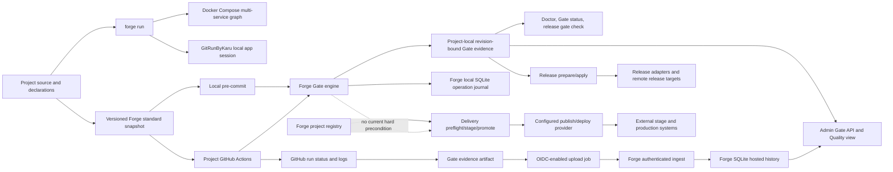
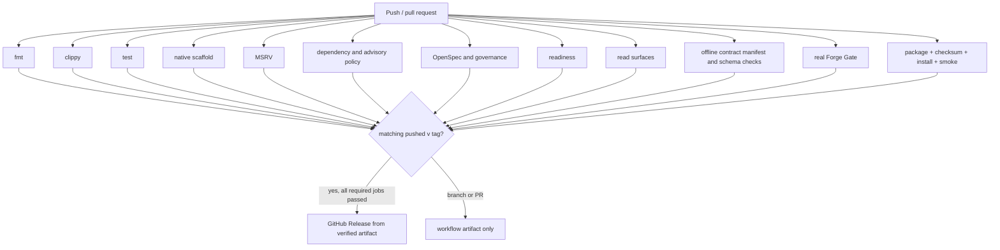

# Forge CI/CD system model

This guide describes the current command and data paths in Forge. It separates implemented behavior from missing handoffs and unverified remote settings. It is a map for maintainers, not a claim that Forge is a hosted CI service. Forge's product boundary currently says it is not a generic CI/CD replacement ([README product boundaries](../README.md#product-boundaries)).

## 1. Model at a glance

Forge composes several owners:

| Owner | Responsibility | Main interface | Main state/evidence |
|---|---|---|---|
| Forge project model | Project identity, profile, standard pack, declared checks and configured targets | `forge.yaml`, `.project.json`, `.forge/` | Local project files and the Forge SQLite registry |
| Forge Gate | Mandatory baseline, project extensions, verdict, source revision | `forge gate`, `forge gate status`, authenticated admin Gate routes | `.forge/gate/<project-id>/evidence.json` plus local operation journal |
| Project verification | Language/framework-specific checks supplied by the standard snapshot or project extension | `.standard/scripts/verify.sh`, `verify-local.sh`, declared Gate commands | Command output captured in Gate or hosted CI logs |
| Local development runtime | Start one Compose project graph or one app process directory | `forge run compose`, `forge run local` | Runtime-owned process/container state; Forge does not persist a session or claim readiness |
| Runtime providers | Multi-service Compose lifecycle or one GitRunByKaru local session | Docker Compose CLI; installed `gitrunbykaru` executable | Compose owns its project containers; GitRunByKaru owns detection/readiness/process cleanup |
| GitHub Actions | Hosted job scheduling, checkout, logs, status checks, workflow artifacts | Generated workflow or Forge's `.github/workflows/ci.yml` | GitHub workflow run, job results and uploaded artifacts |
| Forge release plane | Evaluate release checks and run configured release stages | `forge release prepare` / `forge release apply` | Project release state and local registry operation record |
| Delivery provider | Provider preflight, staged publish/health, production promotion | `forge delivery ...` and `forge-publish-provider/0.1.0` | Local operation journal plus provider-owned external state |
| UI/API | Read or explicitly request Forge operations through the same Core behavior | Admin API and workbench | Projections of Forge local registry and project-local evidence |

The central architectural fact is that these are **separate state stores and workflows**. Shared revision identifiers help compare records, but do not automatically move a record between GitHub, a project checkout, Forge's SQLite registry, a release provider, and a deployment provider.



The hosted path is present in the new standard snapshots. The dashed delivery arrow remains a policy boundary: hosted observations do not satisfy a delivery Gate precondition. GitHub run state remains owned by GitHub; Forge stores a validated observation derived from it.

## 2. Core records and revision model

| Record | Produced by | Stored at | Revision relationship | Read by / effect |
|---|---|---|---|---|
| Project declaration | Forge generation or project owner | `forge.yaml`, `.project.json` | Describes intended profile, verification command, integrations and targets; may outlive a source commit | Import, registry, Gate declaration preflight, generators and tooling |
| Standard snapshot and receipt | `forge new`, `forge standard install`, or explicit upgrade | `.standard/`, root hook/workflow paths, receipt | Pack version/digests identify exact template bytes; updates are explicit and conflict-safe | New project, local hook, hosted project CI |
| Gate evidence | `forge gate` or admin Gate run | `.forge/gate/<project-id>/evidence.json` | Captures Git `HEAD`; evidence is stale if current `HEAD` differs or cannot be established | Gate status, Doctor, release `gate` check, provider matrix, admin status/Quality view |
| Gate operation journal row | Gate CLI/API caller | Local Forge SQLite registry | Associated with the project identity and Gate outcome; separate from the JSON evidence file | Operation history and workbench surfaces |
| GitHub workflow run | GitHub Actions | GitHub | Run is associated with event/ref/SHA and job results | GitHub checks, logs, artifacts; new baseline templates submit a signed Gate observation to Forge |
| Hosted Gate observation | Forge GitHub OIDC ingest | Forge SQLite registry | Bound to signed repository ID, run/attempt, workflow and source SHA | Project Quality checks history; observation only, not local Gate or delivery approval |
| Release plan/checks | `forge release prepare` | Release report/state and local registry | Checks use the captured project revision; Gate check consumes existing evidence and does not run Gate | Operator reviews the plan before apply |
| Release stage result | `forge release apply` and configured adapters | Project release state and registry operation record; remote target is adapter-owned | Release identity contains project/version/source revision | Release status/history; exact external effects depend on adapters |
| Delivery operation | `forge delivery preflight`, `stage`, `promote`, optional Hermora retry | Local SQLite operation journal and provider-owned records | Each operation carries the registered project revision; stage and promotion verify matching revision/confirmation | Delivery status and workbench delivery view |
| CI artifact | Forge artifact job or a project workflow that explicitly uploads one | GitHub Actions artifact storage | Exact artifact bytes and workflow run; digest is used for Forge's package | Forge release job reuses Forge's package artifact; project workflows pass the Gate record to a dependent uploader job |

**Revision nuance:** Gate evidence binds to Git `HEAD`, not an uncommitted working-tree diff. A change to the working tree without a new commit does not by itself change the revision comparison. A successful result therefore proves the captured commit passed the Gate inputs used for that run; it does not prove that arbitrary uncommitted edits pass.

## 3. Flow A — local project checks and pre-commit

1. `forge new` selects a profile-compatible standard pack. Existing projects can adopt or upgrade a pack explicitly. The receipt owns the rendered files and their digests; conflicting edits are refused rather than overwritten. See [standard pack requirements](../openspec/specs/standard-pack-registry-and-snapshots/spec.md).
2. The generated `.pre-commit-config.yaml` invokes repository-wide `forge gate .` with `pass_filenames: false`. It assumes the pre-commit framework and a compatible Forge executable are already installed on the developer's `PATH`.
3. Forge loads its mandatory baseline and any valid project Gate extensions, rehearses/resolves the configured checks, and executes checks with bounded timeouts and output handling. A malformed declaration fails before new evidence is written. A dry run shows the plan but is not evidence.
4. On a real result, Forge classifies each check and aggregate, captures revision/time and writes the Gate evidence file atomically. The caller journals the outcome in the local SQLite registry. A failure remains nonzero; an unavailable runtime or malformed response does not become a pass.
5. Gate status and other readers project the persisted evidence. Absent evidence is `unverified`; a revision mismatch is stale. See [Gate runtime and evidence](../openspec/specs/gate-runtime-evidence/spec.md) and [`src/gate/engine.rs`](../src/gate/engine.rs).

```mermaid
sequenceDiagram
  participant Dev as Developer / pre-commit
  participant Forge as Forge CLI
  participant Decl as Project declaration + Gate extensions
  participant Git as Git HEAD
  participant File as Project .forge evidence
  participant DB as Local Forge registry
  Dev->>Forge: forge gate . --profile fast
  Forge->>Decl: validate declaration; select fast scope
  Forge->>Git: capture HEAD
  Forge->>Forge: execute checks with bounds
  Forge->>File: atomically persist evidence (real run only)
  Forge->>DB: journal verdict
  Forge-->>Dev: structured result + exit code
```

The current generated hook runs the fast profile repository-wide at each
commit attempt. It always checks the Forge source-file line limit, validates
the declaration, and explicitly omits project extensions. Hosted CI runs the
full profile and remains responsible for project build, test, security and
other declared checks. Delivery accepts only fresh passing full-profile
evidence.

### Local development runtime entry points

`forge run compose` delegates a project service graph to `docker compose`;
Compose owns service selection, dependencies, health checks and teardown. When
no action is supplied, Forge defaults to `up`; an explicit Compose action and
remaining arguments pass through after `--`. `forge run local [PATH]`
delegates one app directory to an installed `gitrunbykaru` executable, which
owns detection, preparation, readiness and process-session cleanup. This
explicit route never downloads or installs GitRunByKaru. Forge validates
inputs, launches the child with inherited standard streams, and returns its
exit result; it writes no runtime session or readiness evidence. Projects
with multiple related services should represent them in Compose, rather than
expecting Forge to coordinate independent process sessions. Both commands are
CLI-only in the web catalog because they launch processes on the operator's
machine; they are unrelated to hosted CI execution and deployment readiness.

Examples and exact CLI options are documented in
[`local-runtime-entrypoints.md`](local-runtime-entrypoints.md).

## 4. Flow B — generated project GitHub Actions

Current service and client packs are `baseline-service@1.6.0` and `baseline-client@1.3.0`; the defaults are declared in [`src/standard/layout.rs`](../src/standard/layout.rs). Their workflow files live under [`standards/`](../standards/). These versions use fast local hooks and full hosted Gate runs.

### Service profiles

The service workflow runs on push and pull request, grants `contents: read` to the verify job, and has a 45-minute job timeout. It checks out the source, installs Forge `0.1.1` for Linux x86_64 from a matching GitHub Release after checking the SHA-256 sidecar, runs `.standard/scripts/verify.sh` for project verification, then invokes `forge gate . --profile full`. It preserves the Gate file as an artifact even when Gate blocks. The dependent uploader job receives `id-token: write` only when a Gate record and endpoint are present, so terminal blocked observations can be recorded without turning the verify job green.

The standard verifier is a generated wrapper around repository-root `verify-local.sh`; the shared script is bundled into the snapshot by Forge. The service-specific verifier and Forge Gate are separate checks. A failure in either command makes the verification job fail.

### Client profiles

The client workflow also installs Forge `0.1.1` and runs `forge gate . --profile full`. Its verification wrapper is Gate-only at this pack version; it does not claim separate React/Flutter native build/test coverage. It uses the same artifact and OIDC uploader path as the service workflow. The generated pre-commit hook selects `fast` and enforces the built-in baseline before each commit.

### Hosted evidence boundary

The `baseline-service@1.6.0` and `baseline-client@1.3.0` workflows upload only `.forge/gate/<project-id>/evidence.json` as an artifact after full-profile verification, including when Gate produces a terminal blocked record. The artifact action is explicitly allowed to include this hidden path. A dependent branch-push job requests a GitHub Actions ID token with the fixed `forge-ci-evidence` audience and runs the pinned uploader. Only this job receives `id-token: write`; pull requests display a skip notice and never receive that permission. The endpoint is configured as the repository variable `FORGE_CI_EVIDENCE_URL`. The uploader and Forge ingestion both reject fast-profile records; legacy `0.1.0` records without profile metadata retain their historical full meaning.

Forge verifies the RS256 signature against GitHub's published JWKS, fixed issuer/audience and time claims, and exact repository/run/workflow/SHA identity. An operator must first bind the numeric GitHub repository ID in the project's Quality checks panel. The binding must match the project's registered GitHub remote and is immutable. Accepted records are append-only and replay-safe; their full envelope remains in Forge SQLite. The API returns at most 20 recent rows with freshness against the project's current Git revision.

This is an authenticated observation import, not a remote CI executor or universal check status. It does not change local `.forge` Gate evidence, delivery readiness, GitHub branch protection, release checks, or actual deployment health. A Gate blocked result may be stored while its GitHub verification job remains failed. A missing Forge endpoint visibly skips upload; a configured endpoint failure fails the uploader job as well. Existing snapshots remain unchanged until explicitly upgraded.
The templates currently target GitHub Actions on Ubuntu x86_64. Forge `v0.1.1` must be published for the new snapshots to install in hosted CI; this repository change does not publish it. Pack construction and release preparation do not prove that a real release asset exists. See [portable binary distribution](../openspec/specs/forge-portable-binary-distribution/spec.md).

## 5. Flow C — Forge's own CI and binary release

Forge's own [`ci.yml`](../.github/workflows/ci.yml) has named jobs for formatting, Clippy, fast tests, native scaffold evidence, MSRV, dependency/advisory checks, governance/OpenSpec, readiness, read surfaces, offline contract schema validation, Forge Gate, and package artifact verification. Each has an explicit timeout and read-only permissions, except the final release job which has `contents: write`.



The artifact job packages Forge, verifies its digest, installs into a scratch prefix, smoke-tests the installed binary, and uploads the archive plus checksum as a workflow artifact. Only an operator-pushed tag matching the Cargo version can activate the release job; that job downloads the verified artifact and publishes it to a GitHub Release. Branch and pull-request runs do not publish. This is CI plus tag-gated artifact publication, not a hosted service that continuously builds arbitrary sibling projects.

HANDOFF records historical verification snapshots for these workflows. Those entries prove the commands that passed at the recorded commit/time only; they do not establish the current remote workflow status or currently published release assets.

## 6. Flow D — project release preparation and apply

The release plane is distinct from GitHub Actions and from staged delivery:

1. `forge release prepare` captures the project revision and evaluates the configured release checks into a reviewable report.
2. Its `gate` check reads the newest persisted Gate evidence. It does **not** run Gate. Fresh `Passed` evidence at the same revision satisfies that check; missing evidence is unavailable; stale evidence is stale; blocked/failed/unknown aggregates fail the release check.
3. Other release checks and declared stages are evaluated according to the project release configuration. The operator reviews the plan/report and invokes `forge release apply` explicitly.
4. Apply executes configured adapters/stages and persists release state and operation evidence. External publication is performed by the configured adapter/target and must be verified at that boundary.

The dependency is therefore `run Gate at revision R` → `prepare release at revision R` → review → explicit apply. A local Gate result is not automatically refreshed by prepare. Changing the commit between these operations invalidates its Gate evidence for the new revision.

## 7. Flow E — provider-backed staged delivery

The delivery engine records a separate state machine in the local Forge registry:

```mermaid
stateDiagram-v2
  [*] --> draft
  draft --> preflighted: provider preflight succeeded at revision R
  draft --> preflight_failed: provider missing or failed
  preflighted --> stage_healthy: confirm preflight operation; stage healthy at R
  preflighted --> stage_failed: stage/build/health failed
  stage_healthy --> production_healthy: confirm exact registered revision R
  stage_healthy --> production_failed: provider failed
  production_healthy --> hermora_pending: optional site enrollment
  hermora_pending --> hermora_connected: enrollment succeeds
  hermora_pending --> hermora_failed: enrollment unavailable/fails
```



`forge delivery preflight` resolves the registered project, verifies current Git `HEAD` equals the registered revision, requires non-dry-run fresh passing Gate evidence for that project/revision, then resolves the provider, invokes provider preflight, and records `delivery.preflight`. `stage` requires a successful preflight operation ID for the same project and revision. `promote` requires a healthy stage plus explicit confirmation of the registered revision. Idempotency keys prevent duplicate identical operations; changed inputs conflict. Optional Hermora enrollment is a separate retryable operation after successful deployment.

In [`src/delivery/handlers.rs`](../src/delivery/handlers.rs), `run_preflight` checks that Git `HEAD` matches the registered revision and consumes persisted Forge Gate evidence before provider resolution or operation reservation. Only non-dry-run `passed` evidence fresh for that revision allows provider preflight. Forge does not run Gate implicitly; missing, stale or non-passing evidence tells the operator to run `forge gate`, and a changed commit requires `forge register` first. This protects local delivery preflight. Hosted observations are now imported into Forge's separate history, but they do not satisfy the local delivery precondition.

Before any verb is reserved, Forge asks the provider which operations it declares (`capabilities`) and refuses a verb the provider did not declare. A provider that makes no readable claim is treated as unknown: `preflight` and `publish` are served, newer operations are not attempted. See [`docs/adapter-contracts/publish-provider.md`](adapter-contracts/publish-provider.md#capabilities).

## 8. Interfaces and ownership seams

| Seam | Current contract/behavior | Owner | Known boundary |
|---|---|---|---|
| Gate CLI → Gate engine | CLI invokes bundled Forge Gate; baseline cannot be disabled; extensions add checks | Forge | Same engine is used locally and by generated workflows; hosted runs are retained as separate observations |
| Gate → persisted evidence | Versioned structured envelope, revision, check rows, aggregate, bounded/redacted diagnostics | Forge | Stored in project tree; journal is in local registry; these two stores can be copied/observed separately |
| Gate → workbench | Authenticated status and explicit re-run routes; workbench projects the same evidence | Forge | README documents this API boundary; the HTTP caller must still be authorized for the managed project |
| Generated workflow → Forge binary | Exact version and checksum sidecar from GitHub Release; read-only workflow permissions | Forge pack + GitHub | Current template target is Linux x86_64; published release availability is a separate prerequisite |
| Release engine → external release target | Project configuration and adapter contracts; prepare is read/evaluate, apply performs explicit stages | Forge + configured adapters | Source alone does not establish that a real external target is configured or currently healthy |
| Delivery engine → provider | `forge-publish-provider/0.1.0`; typed preflight/stage/promote requests, operation journal, revision checks; each verb probes the provider's declared `capabilities` and refuses a verb the provider did not declare, before reserving the operation | Forge coordinates; provider owns external execution | Preflight requires fresh local Gate evidence; hosted history is not accepted as that local approval |
| GitHub → Forge workbench | Generated baseline workflows upload a signed Gate observation through GitHub OIDC; admin UI reads the stored history | GitHub owns the run; Forge verifies and stores the observation | Hosted history does not replace local Gate evidence or prove branch protection |

## 9. How smooth is the system today?

**Smooth within each lane:** the local hook and generated CI call the Forge Gate; Gate has a single baseline-plus-extension policy; the result is structured and revision-bound; release preparation refuses to treat missing or stale Gate evidence as success; delivery stage and promotion require explicit same-revision operation confirmations; Forge's own binary release is held behind its named CI jobs and verified artifact.

**Discontinuous across lanes:** hosted Gate observations now reach Forge's project history, but remain separate from the local Gate evidence file and delivery precondition; release and delivery maintain separate state machines; project workflow results and Forge delivery events do not become one cross-system timeline automatically. Operators still correlate records by project, revision, run and operation identity.

## 10. Gap register and recommended order

Ranks describe system risk and dependency order, not a claim that all work belongs in one package.

| Rank | Gap | Evidence | User/operator impact | Bounded next work |
|---|---|---|---|---|
| **Done — authenticated evidence handoff** | New baseline workflows transfer signed hosted Gate observations into Forge | OIDC verifier, immutable repository binding, append-only SQLite history, admin routes and Quality checks reader; `hosted-ci-evidence-ingest` specification | Hosted history is available to Forge operators but does not satisfy local delivery Gate evidence or prove branch protection | Implemented in `forge-hosted-ci-evidence-ingest`. Existing snapshots require an explicit upgrade; GitHub remains the scheduler and branch-protection authority. |
| **Done — release-to-delivery Gate join** | Delivery preflight now requires current registered Git `HEAD` and fresh passing Forge Gate evidence before provider resolution or journal reservation | `run_preflight` uses the registered revision, actual Git `HEAD`, persisted Gate evidence and shared freshness classifier; `project-to-production-workflow` specifies the precondition | Local delivery cannot silently report provider acceptance as Forge Gate approval; hosted history remains separate | Complete in `forge-delivery-gate-precondition`. Forge does not run Gate automatically; operators run Gate and re-register changed commits. |
| **Done — unified project timeline** | CI, Gate, release, delivery and optional post-publish enrollment had separate records and views | Authenticated read projection joins hosted observations, latest local Gate evidence, releases, deploys and relevant journal rows with per-source coverage | Operators can follow source-owned events by project and revision; the timeline does not query remote systems or fabricate an aggregate result | Implemented in `web-project-delivery-timeline`. GitHub rows are observations received by Forge; local Gate history is latest-only; source owners remain authoritative. |
| **Done — local/hosted Gate profile parity** | Current generated hooks use `fast`; hosted CI and upload use `full`; both preserve the mandatory baseline | Forge profiles are explicit in CLI/evidence; new immutable service/client snapshots select fast locally and full in CI; delivery and hosted ingestion reject fast evidence | Local commits run the mandatory line-count baseline; configured extensions remain authoritative in hosted CI and delivery evidence | Implemented in `gate-local-hosted-profiles`. New workflow assets pin Forge `0.1.1`; that release must exist before hosted installation works. |
| **P1 — duplicate test cost inside Forge CI** | Forge's `.ai-gate/gate.yaml` still binds `tests` and `declared-verification` to overlapping test suites; named CI jobs overlap further | Manifest comments identify both test-bearing Gate checks; `.github/workflows/ci.yml` separately runs named test jobs | Forge CI repeats expensive tests and can spend time rebuilding test dependencies | Measure each suite and remove only proven duplicate execution while preserving `.project.json` declared-verification and named CI coverage. |
| **P1 — template/runtime version maintenance** | New pack workflow pins Forge `0.1.1`; local hook still resolves whichever `forge` is on `PATH` | Installer is exact and checksum-verified; pre-commit invokes the CLI from PATH | Local and hosted behavior can differ by Forge version; old snapshots do not silently receive fixes | Add a visible supported-version check to hook/CI output and a conflict-safe pack upgrade path; document version support and deprecation cadence. Keep old snapshots reproducible. |
| **P1 — binary portability** | Current generated CI supports GitHub Actions Ubuntu x86_64 only | Installer hard-codes `x86_64-unknown-linux-gnu`; README states additional platforms need native evidence | Projects on macOS/Windows/ARM or another CI host cannot use the same generated path without adaptation | Add target-specific binary assets and installer variants only with native package, checksum, install, and smoke evidence. Keep host selection explicit. |
| **Done — local development runtime entry points** | `forge run` exposes explicit Compose-stack and local-app entry points with executable, path, argument and status boundaries | `src/cli/local_runtime.rs`, `tests/local_runtime_entrypoints.rs`, the authenticated command catalog and this guide; Docker Compose and GitRunByKaru retain runtime ownership | Operators get one discoverable Forge command surface for multi-service Compose projects and single local app processes without a second service schema | Implemented in `forge-multiservice-local-runtime`. Compose is the coordinated multi-service model; separate local process sessions are intentionally not jointly supervised. CI remains a separate verification lane. |
| **P2 — external policy proof** | Repository source cannot prove branch protection, GitHub required-check configuration, provider credentials/health, or actual deployment state | These are remote settings/runtime outcomes, not encoded as local source facts | A green workflow may not be required for merge; configured adapters may be unavailable | Capture live, read-only GitHub/provider evidence in operational readiness checks; label missing permissions/config as unknown, never infer from YAML. |

### Suggested dependency sequence

1. Reduce duplicate check cost inside Forge CI after mapping suite overlap and timing on supported CI jobs.
2. Expand platform distribution and multi-service local/runtime support on their own acceptance paths.

Do not start by building a generic Forge-hosted scheduler. GitHub Actions already schedules the generated project workflows, and Forge's existing boundary explicitly avoids becoming a generic CI replacement. Forge's useful role is to generate checks, provide the policy engine, retain trustworthy evidence, and coordinate explicit release/deployment operations.

## 11. Source map

- Project-facing behavior and current template versions: [README — Forge Gate](../README.md#forge-gate), [standard layout](../src/standard/layout.rs), [service workflow](../standards/baseline-service/1.6.0/ci/verify.yml), [client workflow](../standards/baseline-client/1.3.0/ci/verify.yml), [pre-commit template](../standards/baseline-service/1.6.0/.pre-commit-config.yaml).
- Gate execution, persistence and projections: [`src/gate/engine.rs`](../src/gate/engine.rs), [`src/gate/projection.rs`](../src/gate/projection.rs), [`src/api/admin/gate.rs`](../src/api/admin/gate.rs), [Gate spec](../openspec/specs/gate-runtime-evidence/spec.md).
- Forge CI and release boundary: [`.github/workflows/ci.yml`](../.github/workflows/ci.yml), [artifact and CI spec](../openspec/specs/artifact-and-ci-baseline/spec.md), [portable distribution spec](../openspec/specs/forge-portable-binary-distribution/spec.md).
- Project release check: [`src/release/engine/prepare.rs`](../src/release/engine/prepare.rs), [release readiness docs](release-readiness.md).
- Unified operator timeline: [`src/api/admin/history.rs`](../src/api/admin/history.rs), Delivery page, [timeline spec](../openspec/specs/web-project-delivery-timeline/spec.md). It joins existing records on demand and reports per-source scope/availability; it does not add persistence or remote polling.
- Staged delivery and provider ownership: [`src/delivery/handlers.rs`](../src/delivery/handlers.rs), [project-to-production spec](../openspec/specs/project-to-production-workflow/spec.md), [`docs/adapter-contracts/publish-provider.md`](adapter-contracts/publish-provider.md).
- Remaining service/runtime/facade work: [consolidation roadmap](../ROADMAP.md#forge-source-consolidation-and-retirement), [current HANDOFF](../HANDOFF.md#remaining-consolidation-work).

## 12. Evidence limits

This guide is derived from checked-in source, templates, canonical specifications, roadmap, and recorded HANDOFF evidence. It does not query GitHub branch protection, workflow runs, published Release assets, provider endpoints, credentials, production health, or a live sibling project. Historical PASS entries apply to their recorded revision and time only. Verify those remote conditions independently before treating an external integration as operational.
