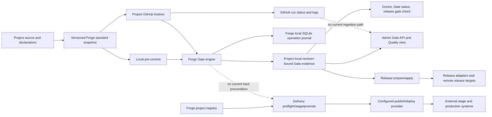
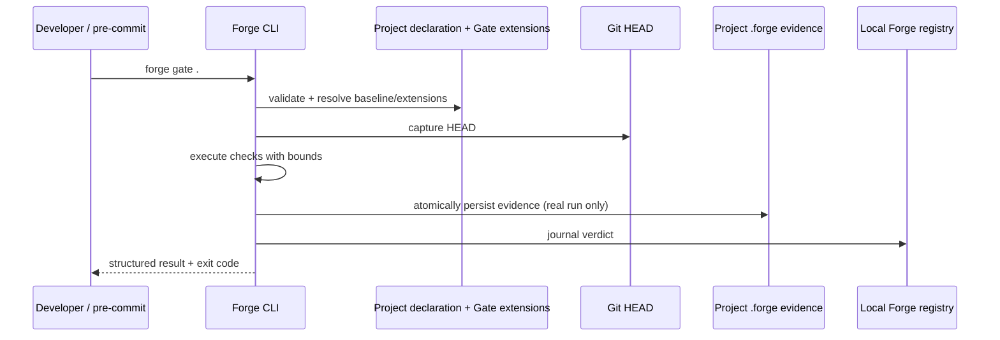
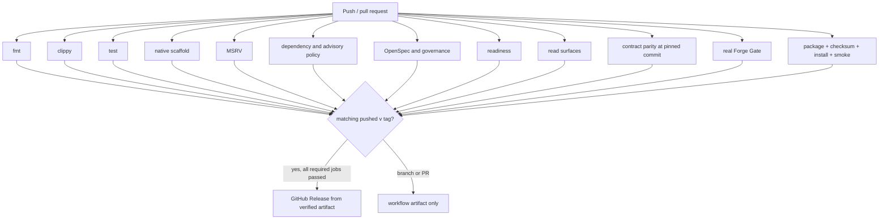

# Forge CI/CD system model

This guide describes the current command and data paths in Forge. It separates implemented behavior from missing handoffs and unverified remote settings. It is a map for maintainers, not a claim that Forge is a hosted CI service. Forge's product boundary currently says it is not a generic CI/CD replacement ([README product boundaries](../README.md#product-boundaries)).

## 1. Model at a glance

Forge composes several owners:

| Owner | Responsibility | Main interface | Main state/evidence |
|---|---|---|---|
| Forge project model | Project identity, profile, standard pack, declared checks and configured targets | `forge.yaml`, `.project.json`, `.forge/` | Local project files and the Forge SQLite registry |
| Forge Gate | Mandatory baseline, project extensions, verdict, source revision | `forge gate`, `forge gate status`, authenticated admin Gate routes | `.forge/gate/<project-id>/evidence.json` plus local operation journal |
| Project verification | Language/framework-specific checks supplied by the standard snapshot or project extension | `.standard/scripts/verify.sh`, `verify-local.sh`, declared Gate commands | Command output captured in Gate or hosted CI logs |
| GitHub Actions | Hosted job scheduling, checkout, logs, status checks, workflow artifacts | Generated workflow or Forge's `.github/workflows/ci.yml` | GitHub workflow run, job results and uploaded artifacts |
| Forge release plane | Evaluate release checks and run configured release stages | `forge release prepare` / `forge release apply` | Project release state and local registry operation record |
| Delivery provider | Provider preflight, staged publish/health, production promotion | `forge delivery ...` and `forge-publish-provider/0.1.0` | Local operation journal plus provider-owned external state |
| UI/API | Read or explicitly request Forge operations through the same Core behavior | Admin API and workbench | Projections of Forge local registry and project-local evidence |

The central architectural fact is that these are **separate state stores and workflows**. Shared revision identifiers help compare records, but do not automatically move a record between GitHub, a project checkout, Forge's SQLite registry, a release provider, and a deployment provider.

Dashed arrows are gaps or absent handoffs, not implemented data movement. The GitHub evidence and delivery-Gate observations follow from inspecting the templates, API reader, release check and delivery handler; they should be treated as source-based findings until an explicit importer/orchestrator is implemented.

## 2. Core records and revision model

| Record | Produced by | Stored at | Revision relationship | Read by / effect |
|---|---|---|---|---|
| Project declaration | Forge generation or project owner | `forge.yaml`, `.project.json` | Describes intended profile, verification command, integrations and targets; may outlive a source commit | Import, registry, Gate declaration preflight, generators and tooling |
| Standard snapshot and receipt | `forge new`, `forge standard install`, or explicit upgrade | `.standard/`, root hook/workflow paths, receipt | Pack version/digests identify exact template bytes; updates are explicit and conflict-safe | New project, local hook, hosted project CI |
| Gate evidence | `forge gate` or admin Gate run | `.forge/gate/<project-id>/evidence.json` | Captures Git `HEAD`; evidence is stale if current `HEAD` differs or cannot be established | Gate status, Doctor, release `gate` check, provider matrix, admin status/Quality view |
| Gate operation journal row | Gate CLI/API caller | Local Forge SQLite registry | Associated with the project identity and Gate outcome; separate from the JSON evidence file | Operation history and workbench surfaces |
| GitHub workflow run | GitHub Actions | GitHub | Run is associated with event/ref/SHA and job results | GitHub checks, logs, artifacts; current templates do not import this record into Forge |
| Release plan/checks | `forge release prepare` | Release report/state and local registry | Checks use the captured project revision; Gate check consumes existing evidence and does not run Gate | Operator reviews the plan before apply |
| Release stage result | `forge release apply` and configured adapters | Project release state and registry operation record; remote target is adapter-owned | Release identity contains project/version/source revision | Release status/history; exact external effects depend on adapters |
| Delivery operation | `forge delivery preflight`, `stage`, `promote`, optional Hermora retry | Local SQLite operation journal and provider-owned records | Each operation carries the registered project revision; stage and promotion verify matching revision/confirmation | Delivery status and workbench delivery view |
| CI artifact | Forge artifact job or a project workflow that explicitly uploads one | GitHub Actions artifact storage | Exact artifact bytes and workflow run; digest is used for Forge's package | Forge release job reuses Forge's package artifact; project workflow currently has no Gate-evidence upload step |

**Revision nuance:** Gate evidence binds to Git `HEAD`, not an uncommitted working-tree diff. A change to the working tree without a new commit does not by itself change the revision comparison. A successful result therefore proves the captured commit passed the Gate inputs used for that run; it does not prove that arbitrary uncommitted edits pass.

## 3. Flow A — local project checks and pre-commit

1. `forge new` selects a profile-compatible standard pack. Existing projects can adopt or upgrade a pack explicitly. The receipt owns the rendered files and their digests; conflicting edits are refused rather than overwritten. See [standard pack requirements](../openspec/specs/standard-pack-registry-and-snapshots/spec.md).
2. The generated `.pre-commit-config.yaml` invokes repository-wide `forge gate .` with `pass_filenames: false`. It assumes the pre-commit framework and a compatible Forge executable are already installed on the developer's `PATH`.
3. Forge loads its mandatory baseline and any valid project Gate extensions, rehearses/resolves the configured checks, and executes checks with bounded timeouts and output handling. A malformed declaration fails before new evidence is written. A dry run shows the plan but is not evidence.
4. On a real result, Forge classifies each check and aggregate, captures revision/time and writes the Gate evidence file atomically. The caller journals the outcome in the local SQLite registry. A failure remains nonzero; an unavailable runtime or malformed response does not become a pass.
5. Gate status and other readers project the persisted evidence. Absent evidence is `unverified`; a revision mismatch is stale. See [Gate runtime and evidence](../openspec/specs/gate-runtime-evidence/spec.md) and [`src/gate/engine.rs`](../src/gate/engine.rs).

The hook runs the whole Gate at each commit attempt, not only checks related to staged filenames. That preserves repository-wide requirements, but may make commits expensive for projects whose Gate includes full builds and test suites.

## 4. Flow B — generated project GitHub Actions

Current service and client packs are `baseline-service@1.4.0` and `baseline-client@1.1.0`; the defaults are declared in [`src/standard/layout.rs`](../src/standard/layout.rs). Their workflow files live under [`standards/`](../standards/).

### Service profiles

The service workflow runs on push and pull request, grants `contents: read`, and has a 45-minute job timeout. It checks out the source, installs Forge `0.1.0` for Linux x86_64 from a matching GitHub Release after checking the SHA-256 sidecar, runs `.standard/scripts/verify.sh`, then invokes `forge gate .`.

The standard verifier is a generated wrapper around repository-root `verify-local.sh`; the shared script is bundled into the snapshot by Forge. The service-specific verifier does not replace the Gate. A failure in either command makes the workflow fail.

### Client profiles

The client workflow also installs the pinned Forge release and runs Gate. Its verification wrapper is Gate-only at this pack version; it does not claim separate React/Flutter native build/test coverage.

### Hosted evidence boundary

GitHub retains the workflow run, logs and check result. Gate also writes `.forge/gate/.../evidence.json` and journals into the runner's local Forge registry during that run. The current generated workflows do not upload the Gate file or send it to a Forge evidence endpoint. The runner workspace/registry is ephemeral after the job. Therefore:

- GitHub can show a passing project CI check.
- Forge running on a developer machine can still show absent or stale Gate evidence for that commit.
- `forge release prepare` on a separate machine cannot consume runner-local Gate evidence unless an operator or another mechanism copies/imports it.
- This is an inference from the workflow templates and the local evidence readers, not a claim about any separately configured GitHub integration.

The templates currently target GitHub Actions on Ubuntu x86_64. The pinned Forge `v0.1.0` release must exist for installation to work; pack construction and release preparation do not prove that a real release asset has been published. See [portable binary distribution](../openspec/specs/forge-portable-binary-distribution/spec.md).

## 5. Flow C — Forge's own CI and binary release

Forge's own [`ci.yml`](../.github/workflows/ci.yml) has named jobs for formatting, Clippy, fast tests, native scaffold evidence, MSRV, dependency/advisory checks, governance/OpenSpec, readiness, read surfaces, contract parity, Forge Gate, and package artifact verification. Each has an explicit timeout and read-only permissions, except the final release job which has `contents: write`.

The artifact job packages Forge, verifies its digest, installs into a scratch prefix, smoke-tests the installed binary, and uploads the archive plus checksum as a workflow artifact. Only an operator-pushed tag matching the Cargo version can activate the release job; that job downloads the verified artifact and publishes it to a GitHub Release. Branch and pull-request runs do not publish. This is CI plus tag-gated artifact publication, not a hosted service that continuously builds arbitrary sibling projects.

HANDOFF records historical verification snapshots for these workflows. Those entries prove the commands that passed at the recorded commit/time only; they do not establish the current remote workflow status or currently published release assets.

## 6. Flow D — project release preparation and apply

The release plane is distinct from GitHub Actions and from staged delivery:

1. `forge release prepare` captures the project revision and evaluates the configured release checks into a reviewable report.
2. Its `gate` check reads the newest persisted Gate evidence. It does **not** run Gate. Fresh `Passed` evidence at the same revision satisfies that check; missing evidence is unavailable; stale evidence is stale; blocked/failed/unknown aggregates fail the release check.
3. Other release checks and declared stages are evaluated according to the project release configuration. The operator reviews the plan/report and invokes `forge release apply` explicitly.
4. Apply executes configured adapters/stages and persists release state and operation evidence. External publication is performed by the configured adapter/target and must be verified at that boundary.

The dependency is therefore `run Gate at revision R` → `prepare release at revision R` → review → explicit apply. A local Gate result is not automatically refreshed by prepare. Changing the commit between these operations invalidates its Gate evidence for the new revision.

## 7. Flow E — provider-backed staged delivery

The delivery engine records a separate state machine in the local Forge registry:

```mermaid
stateDiagram-v2
  [*] --> draft
  draft --> preflighted: provider preflight succeeded at revision R
  draft --> preflight_failed: provider missing or failed
  preflighted --> stage_healthy: confirm preflight operation; stage healthy at R
  preflighted --> stage_failed: stage/build/health failed
  stage_healthy --> production_healthy: confirm exact registered revision R
  stage_healthy --> production_failed: provider failed
  production_healthy --> hermora_pending: optional site enrollment
  hermora_pending --> hermora_connected: enrollment succeeds
  hermora_pending --> hermora_failed: enrollment unavailable/fails
```

`forge delivery preflight` resolves the registered project, captures its registered revision, resolves the configured provider, invokes provider preflight, and records `delivery.preflight`. `stage` requires a successful preflight operation ID for the same project and revision. `promote` requires a healthy stage plus explicit confirmation of the registered revision. Idempotency keys prevent duplicate identical operations; changed inputs conflict. Optional Hermora enrollment is a separate retryable operation after successful deployment.

In [`src/delivery/handlers.rs`](../src/delivery/handlers.rs), `run_preflight` goes directly to the provider; it does not visibly invoke `forge gate` or the release engine. The canonical delivery spec requires provider preflight and revision-safe staging, not a Gate evidence reference. Thus a healthy delivery preflight currently means the configured provider accepted its preflight; it does not, by itself, prove Forge Gate passed. A provider may run its own checks, but that is provider-specific and must not be assumed.

## 8. Interfaces and ownership seams

| Seam | Current contract/behavior | Owner | Known boundary |
|---|---|---|---|
| Gate CLI → Gate engine | CLI invokes bundled Forge Gate; baseline cannot be disabled; extensions add checks | Forge | Same engine is used locally and by generated workflows, but runner evidence is not visibly imported |
| Gate → persisted evidence | Versioned structured envelope, revision, check rows, aggregate, bounded/redacted diagnostics | Forge | Stored in project tree; journal is in local registry; these two stores can be copied/observed separately |
| Gate → workbench | Authenticated status and explicit re-run routes; workbench projects the same evidence | Forge | README documents this API boundary; the HTTP caller must still be authorized for the managed project |
| Generated workflow → Forge binary | Exact version and checksum sidecar from GitHub Release; read-only workflow permissions | Forge pack + GitHub | Current template target is Linux x86_64; published release availability is a separate prerequisite |
| Release engine → external release target | Project configuration and adapter contracts; prepare is read/evaluate, apply performs explicit stages | Forge + configured adapters | Source alone does not establish that a real external target is configured or currently healthy |
| Delivery engine → provider | `forge-publish-provider/0.1.0`; typed preflight/stage/promote requests, operation journal, revision checks | Forge coordinates; provider owns external execution | No direct Gate evidence requirement is visible in delivery preflight |
| GitHub → Forge workbench | No generated-template callback/import is present | GitHub owns the run record; Forge would need an explicit consumer to join it | GitHub job status is not automatically equivalent to Forge's local Gate evidence |

## 9. How smooth is the system today?

**Smooth within each lane:** the local hook and generated CI call the Forge Gate; Gate has a single baseline-plus-extension policy; the result is structured and revision-bound; release preparation refuses to treat missing or stale Gate evidence as success; delivery stage and promotion require explicit same-revision operation confirmations; Forge's own binary release is held behind its named CI jobs and verified artifact.

**Discontinuous across lanes:** GitHub's hosted Gate result is not visibly delivered to Forge's local registry/workbench; the local Gate evidence file does not include the corresponding GitHub run identity/URL; delivery preflight does not visibly require Gate evidence; release and delivery maintain separate state machines; project workflow results and Forge delivery events do not become one cross-system timeline automatically. The system is understandable at the component level, but an operator must manually understand and bridge these seams.

## 10. Gap register and recommended order

Ranks describe system risk and dependency order, not a claim that all work belongs in one package.

| Rank | Gap | Evidence | User/operator impact | Bounded next work |
|---|---|---|---|---|
| **P0 — evidence handoff** | Hosted project CI Gate evidence is not visibly transferred to Forge | Current standard workflows run Gate but have no evidence upload/import callback; Gate status reads project-local evidence | GitHub says pass while Forge may show absent/unverified; release prepare on another host cannot reuse CI result | Define a versioned CI run envelope bound to project ID, full commit SHA, Gate contract/pack versions, per-check states, aggregate, workflow/run/job identity and run URL. Upload from GitHub; add explicit, authenticated, idempotent Forge ingest/read path. Reject wrong project, malformed results, stale SHA, unknown versions, and untrusted claims. Keep the raw GitHub check authoritative for GitHub branch protection. |
| **P0 — release-to-delivery gate join** | Provider delivery can proceed without a Forge Gate evidence check in the delivery handler | `run_preflight` invokes provider directly; delivery spec does not name Gate as prerequisite | “Delivery preflight succeeded” can be mistaken for “Forge quality Gate passed” | Decide and specify whether delivery preflight must consume fresh PASS evidence for the exact registered revision or whether providers explicitly own quality checks. If Forge owns the invariant, enforce it before reserving/invoking provider operations and expose the reason in CLI/API/UI. |
| **P1 — one delivery timeline** | CI, Gate, release, delivery and optional post-publish enrollment have different records and views | Evidence JSON + SQLite operation rows + GitHub run + provider state; no single pipeline/run identity | Operators correlate by project and SHA manually; partial failures can be hard to read end-to-end | Add a read-only project timeline that links immutable run/operation IDs, commit, stage, owner, status, timestamps and source URLs. Preserve each owner as source of truth; do not flatten distinct semantics into one green status. |
| **P1 — local/hosted check parity** | Pre-commit and generated CI run the full Gate, while Forge CI also has named jobs and its test Gate contains overlapping suites | `pass_filenames: false`; service CI runs verifier plus Gate; Forge `.ai-gate/gate.yaml` contains tests and declared-verification; workflow has separately named jobs | Local commit cost, duplicate tests, and differences in which checks are mandatory can surprise developers | Define fast local and full hosted profiles with the same required baseline semantics; make skipped/split checks explicit and report one final aggregate. Measure runtime on supported projects before changing defaults. |
| **P1 — template/runtime version maintenance** | Pack workflow pins Forge `0.1.0`; local hook uses whichever `forge` is on `PATH` | Installer is exact and checksum-verified; pre-commit config invokes bare `forge gate .` | Local/hosted behavior can differ by Forge version; old snapshots do not silently receive fixes | Add a visible supported-version check to hook/CI output and a conflict-safe pack upgrade path; document version support and deprecation cadence. Keep old snapshots reproducible. |
| **P1 — binary portability** | Current generated CI supports GitHub Actions Ubuntu x86_64 only | Installer hard-codes `x86_64-unknown-linux-gnu`; README states additional platforms need native evidence | Projects on macOS/Windows/ARM or another CI host cannot use the same generated path without adaptation | Add target-specific binary assets and installer variants only with native package, checksum, install, and smoke evidence. Keep host selection explicit. |
| **P1 — service topology/runtime model** | CI templates and `forge.yaml` profile flow do not provide one unified multi-service Compose/local-run orchestration model | Roadmap retains `forge-multiservice-local-runtime` to model multiple services and integrate `gitrunbykaru` | Projects with API, worker, UI and dependencies have no single Forge-owned local/CI entry point across Compose and local processes | Complete the roadmap package for service graph and entry points before connecting its graph to CI checks; avoid treating a single repository as necessarily one service. |
| **P2 — external policy proof** | Repository source cannot prove branch protection, GitHub required-check configuration, provider credentials/health, or actual deployment state | These are remote settings/runtime outcomes, not encoded as local source facts | A green workflow may not be required for merge; configured adapters may be unavailable | Capture live, read-only GitHub/provider evidence in operational readiness checks; label missing permissions/config as unknown, never infer from YAML. |

### Suggested dependency sequence

1. Decide the Gate invariant at delivery preflight and document/implement it explicitly.
2. Define the CI result/evidence envelope and its trust/authentication boundary.
3. Upload and ingest hosted evidence with exact project and commit binding.
4. Add the unified project timeline over linked GitHub and Forge operation records.
5. Reduce duplicate check cost and align local/hosted profiles after runtime measurements.
6. Expand platform distribution and multi-service local/runtime support on their own acceptance paths.

Do not start by building a generic Forge-hosted scheduler. GitHub Actions already schedules the generated project workflows, and Forge's existing boundary explicitly avoids becoming a generic CI replacement. Forge's useful role is to generate checks, provide the policy engine, retain trustworthy evidence, and coordinate explicit release/deployment operations.

## 11. Source map

- Project-facing behavior and current template versions: [README — Forge Gate](../README.md#forge-gate), [standard layout](../src/standard/layout.rs), [service workflow](../standards/baseline-service/1.4.0/ci/verify.yml), [client workflow](../standards/baseline-client/1.1.0/ci/verify.yml), [pre-commit template](../standards/baseline-service/1.4.0/.pre-commit-config.yaml).
- Gate execution, persistence and projections: [`src/gate/engine.rs`](../src/gate/engine.rs), [`src/gate/projection.rs`](../src/gate/projection.rs), [`src/api/admin/gate.rs`](../src/api/admin/gate.rs), [Gate spec](../openspec/specs/gate-runtime-evidence/spec.md).
- Forge CI and release boundary: [`.github/workflows/ci.yml`](../.github/workflows/ci.yml), [artifact and CI spec](../openspec/specs/artifact-and-ci-baseline/spec.md), [portable distribution spec](../openspec/specs/forge-portable-binary-distribution/spec.md).
- Project release check: [`src/release/engine/prepare.rs`](../src/release/engine/prepare.rs), [release readiness docs](release-readiness.md).
- Staged delivery and provider ownership: [`src/delivery/handlers.rs`](../src/delivery/handlers.rs), [project-to-production spec](../openspec/specs/project-to-production-workflow/spec.md), [`docs/adapter-contracts/publish-provider.md`](adapter-contracts/publish-provider.md).
- Remaining service/runtime/facade work: [consolidation roadmap](../ROADMAP.md#forge-source-consolidation-and-retirement), [current HANDOFF](../HANDOFF.md#remaining-consolidation-work).

## 12. Evidence limits

This guide is derived from checked-in source, templates, canonical specifications, roadmap, and recorded HANDOFF evidence. It does not query GitHub branch protection, workflow runs, published Release assets, provider endpoints, credentials, production health, or a live sibling project. Historical PASS entries apply to their recorded revision and time only. Verify those remote conditions independently before treating an external integration as operational.
